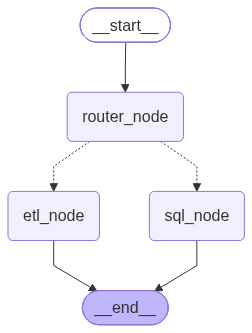

# Data Agent

A multi-agent data assistant built with [LangGraph](https://github.com/langchain-ai/langgraph) and OpenAI models. You ask a question in plain English, a router decides whether it is a **SQL** question or an **ETL** task, and the matching sub-agent handles it.



## How it works

| Agent | File | What it does |
|---|---|---|
| **Data Agent** (router) | `agents/data_agent.py` | Classifies the request as `SQL` or `ETL` with structured output, then calls the matching sub-agent. |
| **SQL Analyst** | `agents/sql_analyst.py` | Turns a natural-language question into a PostgreSQL query and returns a plain-English answer. |
| **ETL Analyst** | `agents/etl_analyst.py` | A tool-calling agent that extracts data from APIs and transforms or saves files. |

**SQL Analyst pipeline**

`curate_question` → `prompt_query_context` (reads the DB schema and sample rows) → `generate_sql` → `is_safe` (an LLM judge rejects anything that is not a read-only query) → `execute_sql` → `represent_final_answer`

If the judge rejects the query, the agent goes to `cancel_sql` instead and returns the judge's justification.

**ETL Analyst tools**

- `extract_load_tool`: fetches JSON from an API endpoint, flattens it with pandas and saves it as CSV, JSON or Parquet.
- `transform_load_tool`: shows an LLM the first rows of a file, asks it to write pandas transformation code, and runs that code.

The LLM picks the tools and loops until the task is done.

## Project structure

```
agents/          LangGraph agents (router, SQL analyst, ETL analyst)
Models/schema.py Pydantic state and structured-output schemas
utils/
  llm_pick.py    Picks an OpenAI model by tier (low / medium / high)
  db_conn.py     PostgreSQL helper (schema introspection, query execution)
  etl_tools.py   Extract, transform and code-execution helpers
data/            Sample ride-share CSVs (users, vehicles, rides, payments, ratings)
feed_db.py       Creates the ride-share tables in PostgreSQL and loads the CSVs
main.py          Entry point that runs the Data Agent
```

## Setup

Requires Python 3.12+ and a PostgreSQL database.

```bash
uv sync
```

Create a `.env` file in the project root:

```
OPENAI_API_KEY=...
host=localhost
port=5432
database=...
user=...
password=...
```

Load the sample data into PostgreSQL (needed only for the SQL Analyst):

```bash
uv run python feed_db.py
```

## Usage

```bash
# Full pipeline: router + sub-agents
uv run python main.py

# SQL Analyst only (interactive chat loop)
uv run python agents/sql_analyst.py

# ETL Analyst only
uv run python agents/etl_analyst.py
```

Example prompts:

- *"Which 5 drivers have the highest average rating?"* (routed to SQL)
- *"Extract data from https://pokeapi.co/api/v2/pokemon and save it to data/extract in CSV format"* (routed to ETL)

## Notes

- `transform_load_tool` runs LLM-generated Python with `exec()` and no sandbox. Use it only on trusted input and in a safe environment.
- The SQL safety check is done by an LLM judge. For real protection, also connect with a read-only database user.
